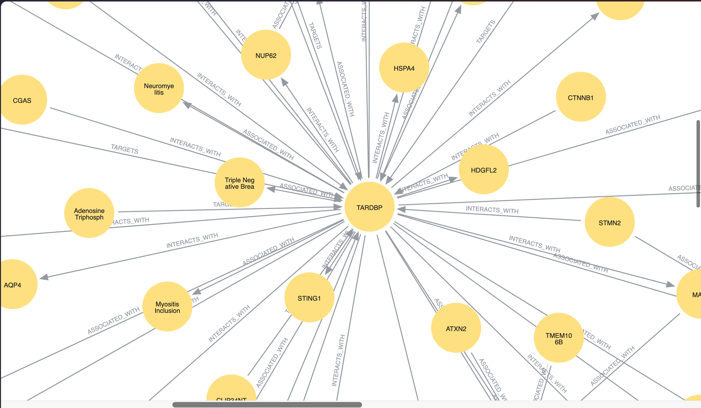
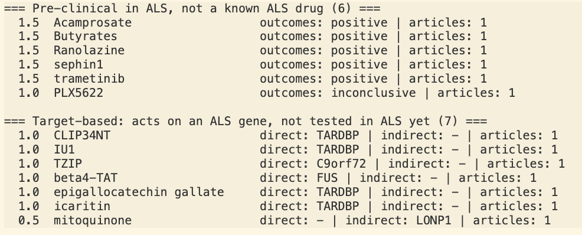

# ALS Knowledge Graph (gene-graph)




A pipeline that reads scientific abstracts about ALS (amyotrophic lateral sclerosis, a disease of
the nerves that control muscles), pulls out "who is linked to whom" (genes, drugs, diseases), and stores
it as a **knowledge graph**. The long-term goal is **drug repurposing**: finding drugs that already exist for another disease and
might also help in ALS.


## What is a knowledge graph? 

A knowledge graph is a network of **things** (nodes) connected by **relationships** (arrows).

```
 [tofersen] --TARGETS--> [SOD1] --ASSOCIATED_WITH--> [ALS]
   (drug)                 (gene)                     (disease)
```

Reading it as a sentence: *"The drug tofersen targets the gene SOD1, and SOD1 is linked to ALS."*
Once many sentences like this are stored together, we can ask questions such as **which drugs act on genes
linked to ALS?**


### **Step 1: Download articles (`src/pubmed_extraction.py`)**
- **What it does:** searches PubMed (the big database of medical papers) for ALS articles and downloads
  their titles and abstracts.

- **How the PubMed searches work (no biology needed)** Think of PubMed as a giant library of medical papers. The two queries in `src/pubmed_extraction.py` are two search commands for that library.

  - **Search symbols**
    - `AND` = both conditions must be true. `OR` = either one is enough. `NOT` = leave this out.
    - `*` = "any ending". `gene*` matches *gene*, *genes* and *genetic*.
    - `[MeSH]` = the official topic label that librarians put on each paper.
    - `"Amyotrophic Lateral Sclerosis"[MeSH]` means "papers officially labeled as being about ALS".
    - `hasabstract` = only papers that have an abstract (a short summary), because that is what we read.

  - **Query 1 (`QUERY`): papers about ALS**
    > Papers labeled ALS that talk about genes, genetics, therapy, drugs or treatment, and have an abstract.
      This is the "about ALS" shelf. It tells us which genes are linked to ALS and which drugs
      have already been tried in ALS.

  - **Query 2 (`QUERY_NON_ALS`): the same genes, but NOT in ALS papers**
    > Papers that mention one of four ALS genes (C9orf72, SOD1, TARDBP, FUS), talk about drugs,
    > inhibitors or therapy, and are NOT labeled ALS.

      This is the "same genes, other diseases" shelf. A gene that matters in ALS can also matter in
      other diseases (for example cancer or dementia), and drugs may already exist there that act
      on that gene. Those drugs are possible candidates for ALS. This is the idea of **drug repurposing**:
      finding new uses for existing drugs.

  - **In short:** Query 1 answers "what do we know about ALS?". Query 2 answers "which drugs are already used on the same genes elsewhere?". The knowledge graph connects the two.

  - **Output:** `data/abstract.json`

### **Step 2: Find the important words (`src/keyword_builder.py`)**
  - **What it does:** sends each abstract to **PubTator**, a tool that highlights genes, diseases and drugs in
  the text and gives each one a standard ID (like a passport number). For example, ALS is always
  `MESH:D000690`, so "ALS" and "amyotrophic lateral sclerosis" end up as the same thing.
  - **Extra fix:** PubTator sometimes tags "ALS" as the wrong disease. A small function (`fix_als`) corrects this.
  - **Output:** `data/keywords.json`

### **Step 3: Find the relationships (`src/associations_llm.py`)**
  - **What it does:** gives an **LLM** (a language model) each abstract and its list of genes, drugs and
  diseases, and asks: *"which of these are connected, and how?"*
  - **Safety checks:** every answer is verified. The IDs must be in the list, the types must make sense
  (a drug cannot be "associated with" another drug), and the sentence the LLM quotes as proof must really
  exist in the abstract. Bad answers are thrown away.
  - **Output:** `data/association.json` (each relation comes with the article number (PMID) and the proof sentence)

  The four relationship types are:

  | Relation | Meaning | Example |
  |----------|---------|---------|
  | `ASSOCIATED_WITH` | gene is linked to a disease | SOD1 -> ALS |
  | `TARGETS` | drug acts on a gene | tofersen -> SOD1 |
  | `TESTED_FOR` | drug was tested in a disease (with the outcome) | riluzole -> ALS (positive) |
  | `INTERACTS_WITH` | two genes work together | gene A <-> gene B |

### **Step 4: Store the graph (`neo4j/query_connection.py`)**
  - **What it does:** loads `association.json` into **Neo4j**, a database made for graphs (nodes and arrows
    instead of tables).
  - **Tip:** rerunning it does not delete old data. To start fresh, run `MATCH (n) DETACH DELETE n` in Neo4j first.

### **Step 5: Explore it (`app.py`)**
  - **What it does:** a **Streamlit** web app that reads Neo4j and shows an interactive map of the graph.
    You can filter by relation type, search a gene or drug, and click a relation to see the exact sentence
    and the PubMed link that support it.

### **Extra: Candidate ranking (`src/candidates.py`)**
- **What it does:** looks for drugs that act on ALS-related genes but are not yet tested in ALS, and
  ranks them.

- **The main idea**
  The question it answers: *"Which drugs act on genes linked to ALS, but are not yet recorded
  as tested in ALS?"* Such drugs are drug-repurposing candidates.

- **Candidate lists**: what counts as a drug, and what counts as already known
  candidates.py` uses two small lists written at the top of the file. They are plain Python sets of lowercase
  names, so they are easy to edit. They are a first version and should be **reviewed by a biologist**.
  
  1. **List 1: `BLOCKLIST` (things that are not drug candidates)**
  The LLM and PubTator sometimes label very common molecules or whole drug classes as "drugs". They appear in the
    results only because an article says they act on a gene, but they are **not meaningful candidates**, so they are
    removed from both candidate lists.

    | Name in the list | Why it is removed |
    |------------------|-------------------|
    | `adenosine triphosphate`, `atp` | The energy molecule found in every cell |
    | `rna`, `dna` | The genetic material itself, not a drug |
    | `rna oligonucleotide`, `oligonucleotide`, `oligonucleotides`, `antisense oligonucleotide` | A class of molecules, not one specific drug |
    | `water`, `oxygen`, `glucose` | Basic molecules of the body |
    | `reactive oxygen species` | A by-product of cell metabolism, not a treatment |
    | `amino acids`, `lipids`, `peptides`, `proteins` | General groups of molecules |
    
    &nbsp;

  2. **List 2: `KNOWN_ALS_DRUGS` (drugs already approved or in late clinical use for ALS)**
  These drugs are **already known in ALS**, so finding them is not a new discovery. They are kept out of the "pre-clinical" candidate list.

    | Name in the list | Comment |
    |------------------|---------|
    | `riluzole` | Long-standing ALS drug |
    | `edaravone` | ALS drug approved in some countries |
    | `tofersen` | Targets SOD1 (a gene linked to ALS) |
    | `4-phenylbutyric acid`, `sodium phenylbutyrate` | Used together with taurursodiol |
    | `ursodoxicoltaurine`, `taurursodiol`, `tauroursodeoxycholic acid` | Different names for the same partner drug |

    Approval status can **differ by country** and can change over time, so this list needs to be checked and
    updated by someone who knows the current situation.

- **Output:** `data/candidates.json` and a printed table. See "Candidate lists" below for how the lists are built.

- **How it works, function by function**

    **1. `flatten()`: split the data per article**
    `association.json` merges several articles into one relation. This function splits it again into one
    row per article, including the publication year. This is needed to filter by year later (time-split test).

    **2. `rank_candidates()`: the core of the file**
    1. Collect the **ALS genes**: every gene with an `ASSOCIATED_WITH` relation to ALS.
    2. Collect the **drugs already tested in ALS** (a `TESTED_FOR` relation to ALS). These are removed,
      because they are not new.
    3. For every `TARGETS` relation (drug acts on a gene):
      - If the gene is an **ALS gene**, it is a **direct** match.
      - If the gene is not an ALS gene but **interacts with one** (`INTERACTS_WITH`), it is an **indirect** match.
    4. Compute the score: **1 point per direct gene + 0.5 points per indirect gene**. Candidates are sorted by
   score, then by the number of supporting articles.

    Examples:
    - `epigallocatechin gallate | direct: TARDBP` means an article says this compound acts on TARDBP,
      and TARDBP is an ALS gene. Score 1.0.
    - `mitoquinone | indirect: LONP1` means mitoquinone acts on LONP1, which interacts with an ALS gene.
      Score 0.5.

- **3. `main()`: the entry point**
  It reads the command-line options, runs the ranking (or the time-split), prints a table, and saves the
  result to `data/candidates.json`.

- **4. How To Read The Result**
  The result show two table which are "Pre clinical in ALS, not a known ALS drug" and "Target-based: acts on an ALS gene, not tested in ALS yet"
  
  - 1. **The heading “Pre-clinical in ALS, not a known ALS drug”** means that these drugs have been tested for ALS in the articles reviewed (with positive results for the first five, and inconclusive results for PLX5622), but they are not established or well-known ALS treatments. In short, while there are positive signals, they are still at the early, pre-clinical research stage.

  - 2. **The “Target-based**” list is different: the drugs included there have not yet been tested for ALS at all. They appear only because the articles mention that these drugs act upon genes associated with ALS (such as TARDBP, C9orf72, or FUS).

  

## How to run

```bash
pip install -r requirements.txt
```

Create a `.env` file (never commit it):

```
NCBI_EMAIL=...
NCBI_API_KEY=...        # optional
LLM_BASE_URL=...        # OpenAI-compatible endpoint
LLM_API_KEY=...
LLM_MODEL=...
NEO4J_URI=...
NEO4J_USER=...
NEO4J_PASSWORD=...
```

```bash
python src/pubmed_extraction.py --limit 20   # without --limit: up to 500 articles
python src/keyword_builder.py
python src/associations_llm.py
python neo4j/query_connection.py             # run from the neo4j/ folder
# streamlit run app.py
python src/candidates.py                     # two candidate lists
python src/candidates.py --min-articles 2    # only drugs supported by 2+ articles

```
